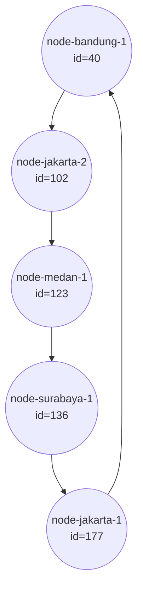
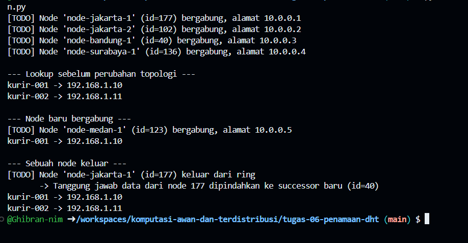

# Tugas 6 (Pekan 6) — Penamaan & Resolusi Lokasi

**Materi terkait:** Flat Naming, Structured Naming (DNS), Distributed Hash Table (DHT)/Chord.

## Studi Kasus

Pelanggan FoodGo kesulitan menemukan alamat IP server kurir yang **dinamis** (kurir berpindah lokasi/jaringan, IP-nya sering berubah). FoodGo butuh cara memetakan **ID Kurir** (identitas tetap) ke **alamat IP terkininya** tanpa server pusat tunggal yang jadi bottleneck/single point of failure.

## Tugas Kelompok

Implementasikan **simulasi Chord DHT** sederhana (single-process, tidak perlu jaringan sungguhan — cukup simulasi struktur data & algoritma di satu program Python) yang memetakan ID Kurir ke alamat IP mereka.

Konsep yang harus terlihat jalan dalam simulasi kalian:
1. **Consistent hashing**: ID Kurir dan ID Node di-hash ke ruang angka yang sama (mis. 0–255 untuk kesederhanaan, `m=8` bit).
2. **Ring topology**: node-node diurutkan melingkar berdasarkan hasil hash-nya.
3. **Lookup**: fungsi `lookup(kurir_id)` yang menemukan node mana yang bertanggung jawab menyimpan mapping ID Kurir tersebut → alamat IP-nya (aturan Chord: node dengan ID hash **terkecil yang lebih besar atau sama dengan** hash key, disebut *successor*).
4. **Perubahan topologi**: simulasikan minimal satu node baru bergabung (`join`) atau satu node keluar (`leave`), tunjukkan bagaimana mapping berpindah tanggung jawab ke node lain.

Skeleton disediakan di `src/chord_simulation.py` dengan fungsi hashing dan struktur ring sudah ada — bagian `lookup()`, `join()`, dan `leave()` sengaja dikosongkan.

### Cara Menjalankan

```bash
python3 src/chord_simulation.py
```

## Tugas Analisis (`README.md`)

1. Jelaskan **kenapa DHT/Chord** lebih cocok untuk kasus ini dibanding **flat naming sederhana** (mis. tabel pusat ID→IP) atau **DNS konvensional** — kaitkan dengan sifat "IP kurir sering berubah" dan kebutuhan tanpa titik gagal tunggal.
2. Gambarkan (boleh pakai Mermaid, lihat Tugas 2) ring topology dari simulasi kalian, tandai node mana yang bertanggung jawab atas ID Kurir mana.
3. Jelaskan apa yang terjadi pada mapping saat sebuah node **keluar** dari ring (siapa yang mengambil alih tanggung jawabnya) — dukung dengan output program.

## Struktur Submission

```
tugas-06-penamaan-dht/
├── README.md      # Analisis + diagram ring
├── JURNAL.md
├── src/
│   └── chord_simulation.py
└── bukti/          # Output program (screenshot/log) untuk skenario join & leave
```

## Rubrik Penilaian (Tugas 6)

| Komponen | Bobot | Kriteria |
|---|---|---|
| Implementasi lookup/join/leave benar | 35% | Consistent hashing & successor lookup sesuai aturan Chord |
| Bukti perubahan topologi (join/leave) | 25% | Output menunjukkan mapping berpindah dengan benar |
| Analisis kenapa DHT vs flat naming/DNS | 25% | Argumen spesifik ke kasus IP kurir dinamis, bukan definisi umum |
| Proses & kontribusi kelompok | 15% | `JURNAL.md`, commit history |

## Batasan Penggunaan AI (Level 2)

Kebijakan **Level 2 (AI Assisted Idea Generation & Structuring)** berlaku — lihat [`../RUBRIK-UMUM.md`](../RUBRIK-UMUM.md). Boleh bertanya konsep umum consistent hashing/Chord ke AI; **tidak boleh** meminta AI menuliskan isi `# TODO` di `src/chord_simulation.py` (`find_successor`, `join`, `leave`, dst). Catat pemakaian AI di "Log Penggunaan AI" pada `JURNAL.md`.

- `README.md` wajib menelusuri manual (langkah demi langkah) bagaimana `lookup()` menemukan successor untuk salah satu ID Kurir contoh yang dipakai di `chord_simulation.py` — bukan cuma menempelkan output program.

## Jawaban
# 1. Kenapa DHT/Chord lebih cocok dibanding flat naming sederhana atau DNS konvensional?

*   **Tanpa Single Point of Failure (SPOF):** Pada *flat naming* sederhana (seperti tabel pusat), jika server pusat *down*, seluruh resolusi alamat akan gagal. DHT mendistribusikan data *mapping* ke banyak node dalam topologi cincin (*ring*). Jika satu node mati, tanggung jawabnya otomatis dialihkan ke node lain (*successor*).
*   **Adaptif terhadap IP Dinamis:** IP kurir sering berubah saat berpindah jaringan. DNS konvensional menggunakan mekanisme *caching* (TTL) yang rentan menyimpan IP usang (*stale data*). DHT/Chord memungkinkan *lookup* dan *update* dilakukan secara *real-time* langsung ke node penanggung jawab tanpa ada *delay* propagasi dari *cache* DNS.

# 2. Ring Topology dari Simulasi

Berdasarkan *output* program saat semua 5 node telah bergabung, node-node menempati *ring* berdasarkan nilai *hash ID*-nya dari yang terkecil hingga terbesar (lalu melingkar kembali ke awal):

*   `node-bandung-1` (id=40)
*   `node-jakarta-2` (id=102)
*   `node-medan-1` (id=123)
*   `node-surabaya-1` (id=136)
*   `node-jakarta-1` (id=177)



# 3. Jelaskan apa yang terjadi pada mapping saat sebuah node **keluar** dari ring (siapa yang mengambil alih tanggung jawabnya) — dukung dengan output program.
Saat sebuah node keluar atau putus dari ring, seluruh tanggung jawab data (kunci) yang sebelumnya dipegang oleh node tersebut akan dipindahkan secara otomatis ke successor barunya (node aktif selanjutnya di dalam ring).
--- Sebuah node keluar ---
[TODO] Node 'node-jakarta-1' (id=177) keluar dari ring
       -> Tanggung jawab data dari node 177 dipindahkan ke successor baru (id=40)
kurir-001 -> 192.168.1.10
kurir-002 -> 192.168.1.11

