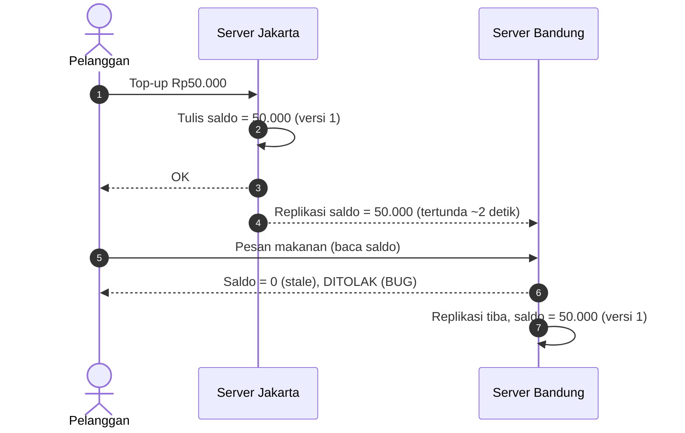
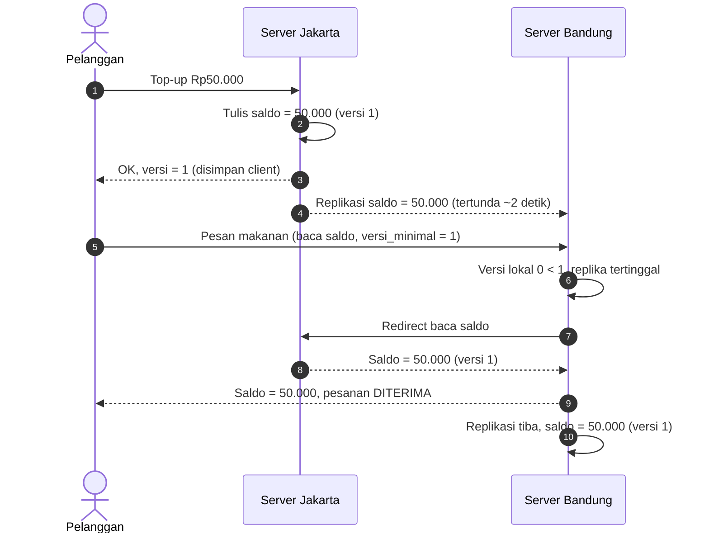

# Tugas 7 (Pekan 7) — Konsistensi Data

**Materi terkait:** Data-Centric Consistency (Sequential, Eventual), Client-Centric Consistency.

## Studi Kasus

Data saldo *e-wallet* pelanggan FoodGo berbeda antara server wilayah **Jakarta** dan **Bandung** karena replikasi antar server berjalan lambat. Contoh kasus nyata: pelanggan top-up saldo lewat server Jakarta, lalu dalam hitungan detik memesan makanan lewat aplikasi yang tersambung ke server Bandung — saldo belum ter-update, transaksi ditolak padahal saldo sebenarnya cukup.

## Tugas Kelompok

### Bagian 1 — Analisis (wajib)

1. Tentukan: apakah kasus ini **membutuhkan Sequential Consistency** (semua replika melihat urutan operasi yang sama) atau **cukup Eventual Consistency** (replika akan konsisten "pada akhirnya", boleh sementara berbeda)? Berikan argumen berbasis dampak bisnis (mis. kasus saldo *e-wallet* jauh lebih sensitif dibanding kasus "jumlah like" di media sosial).
jawab.
Eventual Consistency saja tidak cukup. Replika baru dijamin sama "pada akhirnya", tanpa kepastian kapan dan tanpa jaminan apa yang dibaca selama menunggu. Untuk saldo e-wallet, dampaknya langsung ke bisnis:
Pesanan ditolak padahal saldo cukup, sehingga pelanggan kesal dan pendapatan hilang.
Saldo adalah uang nyata, jadi saldo yang tampak "hilang" memicu keluhan dan churn.
Dua pembayaran yang membaca saldo lama bisa menyebabkan double-spend atau saldo negatif.
Riwayat transaksi harus berurutan agar bisa diaudit.
Pada kasus jumlah like, data yang tertinggal beberapa detik tidak merugikan siapa pun, jadi Eventual sudah cukup. Konsistensi ketat di semua replika memang mahal (latency naik), sehingga yang benar-benar dibutuhkan adalah urutan operasi yang konsisten per akun. Data lain seperti menu dan rating tetap boleh Eventual.

2. Jika kalian menyimpulkan Eventual Consistency saja **tidak cukup** untuk skenario ini, usulkan pendekatan **Client-Centric Consistency** yang relevan (mis. *Read-Your-Writes*: pelanggan yang baru top-up harus selalu melihat saldo terbarunya sendiri, walau replika lain belum sinkron).
3. Gambarkan **diagram alir urutan (sequence diagram)** yang menunjukkan operasi read/write antara pelanggan, server Jakarta, server Bandung, dan proses replikasi — untuk skenario **tanpa** jaminan konsistensi (bug terjadi) DAN skenario **dengan** solusi yang kalian usulkan (bug teratasi). Pakai Mermaid (`sequenceDiagram`) di `README.md` — lihat contoh cara pakai di Tugas 2.

### Soal 1
Apakah kasus ini membutuhkan Sequential Consistency atau cukup Eventual Consistency? Berikan argumen berbasis dampak bisnis.

**Jawab:**
Eventual Consistency saja **tidak cukup**. Replika baru dijamin sama "pada akhirnya", tanpa kepastian kapan dan tanpa jaminan apa yang dibaca selama menunggu. Untuk saldo e-wallet, dampaknya langsung ke bisnis:

- Pesanan ditolak padahal saldo cukup, sehingga pelanggan kesal dan pendapatan hilang.
- Saldo adalah uang nyata, jadi saldo yang tampak "hilang" memicu keluhan dan *churn*.
- Dua pembayaran yang membaca saldo lama bisa menyebabkan *double-spend* atau saldo negatif.
- Riwayat transaksi harus berurutan agar bisa diaudit.

Pada kasus jumlah *like*, data yang tertinggal beberapa detik tidak merugikan siapa pun, jadi Eventual sudah cukup. Konsistensi ketat di semua replika memang mahal (latency naik), sehingga yang benar-benar dibutuhkan adalah urutan operasi yang konsisten **per akun**. Data lain seperti menu dan rating tetap boleh Eventual.

### Soal 2
Jika Eventual Consistency saja tidak cukup, usulkan pendekatan Client-Centric Consistency yang relevan.

**Jawab:**
Pendekatan yang diusulkan adalah **Read-Your-Writes**: pelanggan yang baru top-up harus selalu melihat saldo terbarunya, walau replika lain belum sinkron.

1. Setiap penulisan saldo diberi nomor **versi**.
2. Client menyimpan `versi_minimal`, yaitu versi terakhir yang pernah ia tulis.
3. Setiap pembacaan membawa `versi_minimal`.
4. Jika versi replika **<** `versi_minimal`, pembacaan dialihkan (*redirect*) ke Jakarta atau menunggu replika mengejar. Jika tidak, replika langsung menjawab.

Pada kondisi normal pelanggan tetap dilayani server terdekat, dan hanya kasus langka yang butuh redirect. RYW tidak mencegah dua pembayaran serentak, jadi debit tetap perlu diurutkan per akun.

### Soal 3
Gambarkan diagram alir urutan (sequence diagram) operasi read/write antara pelanggan, server Jakarta, server Bandung, dan proses replikasi, untuk skenario tanpa jaminan konsistensi (bug terjadi) dan dengan solusi (bug teratasi).

**Jawab:**

**a. Tanpa jaminan konsistensi (bug terjadi)**



**b. Dengan solusi Read-Your-Writes (bug teratasi)**


### Bagian 2 — Simulasi (opsional, nilai tambah)

Skeleton `src/replica_simulation.py` mensimulasikan dua replika (Jakarta & Bandung) dengan delay replikasi buatan. Lengkapi TODO untuk:
1. Menunjukkan kondisi **inconsistent read** (replika Bandung masih menunjukkan saldo lama walau Jakarta sudah update).
2. Mengimplementasikan mekanisme **Read-Your-Writes** sederhana (mis. dengan version/timestamp per client) yang memperbaiki masalah tersebut.

```bash
python3 src/replica_simulation.py
```
Kode ada di `src/replica_simulation.py`, dijalankan dengan `python3 src/replica_simulation.py`. Output ada di folder `bukti/`.

| Skenario | Baca dari Bandung | Keterangan |
|---|---|---|
| Naif, 0,5 detik setelah top-up 50.000 | `0.0` | Inconsistent read (bug) |
| Naif, 0,5 detik setelah top-up kedua | `50000.0` | Stale (seharusnya 70.000) |
| Read-Your-Writes, kondisi yang sama | `70000.0` | Benar (redirect ke Jakarta) |

## Struktur Submission

```
tugas-07-konsistensi-data/
├── README.md      # Analisis konsistensi + sequence diagram Mermaid
├── JURNAL.md
├── src/            # (opsional) simulasi replikasi
└── bukti/          # (jika mengerjakan simulasi) output program
```

## Rubrik Penilaian (Tugas 7)

| Komponen | Bobot | Kriteria |
|---|---|---|
| Ketepatan pemilihan model konsistensi | 30% | Argumen berbasis dampak bisnis nyata, bukan hafalan definisi |
| Kualitas sequence diagram | 30% | Menunjukkan jelas titik kegagalan & titik perbaikan |
| Usulan solusi client-centric | 25% | Solusi konkret dan dapat diimplementasikan (bukan wacana abstrak) |
| Proses & kontribusi kelompok | 15% | `JURNAL.md`, commit history (+ bonus jika simulasi dikerjakan) |

## Batasan Penggunaan AI (Level 2)

Kebijakan **Level 2 (AI Assisted Idea Generation & Structuring)** berlaku — lihat [`../RUBRIK-UMUM.md`](../RUBRIK-UMUM.md). Boleh bertanya konsep umum consistency model ke AI untuk brainstorming; **tidak boleh** meminta AI menuliskan analisis akhir/sequence diagram atau isi `# TODO` di `src/replica_simulation.py` yang tinggal ditempel. Catat pemakaian AI di "Log Penggunaan AI" pada `JURNAL.md`.

- Sebagai bukti pemahaman konsep (bukan hafalan jawaban skenario FoodGo saja), `README.md` wajib menyertakan **satu skenario tambahan** yang kalian buat sendiri (mis. kasus lain di aplikasi ojek online) dan menentukan model konsistensi yang tepat untuk skenario tambahan tersebut.
